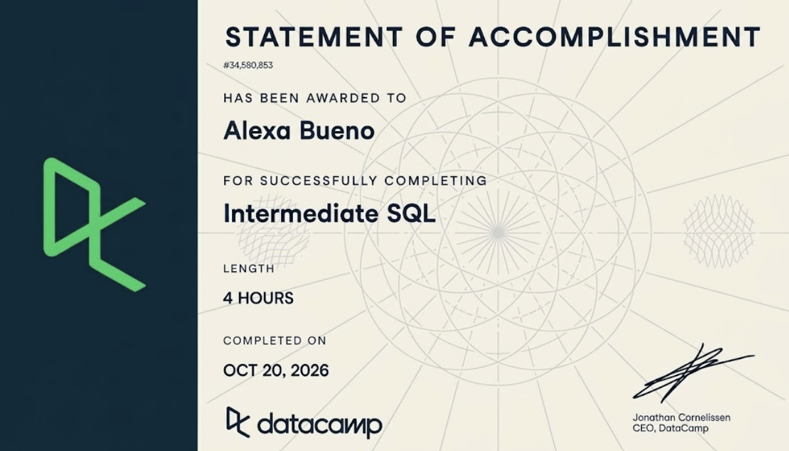

**Course:** IBM 6500

# Course-Completion Evidence



I completed the Intermediate SQL course on DataCamp on October 20, 2026, through the IBM 6500 DataCamp classroom.

# Learning Notes and Key Takeaways

The DataCamp course practiced on a films database (tables such as `films`, `people`, `reviews`, and `roles`). To make these notes useful for my CEP, I rewrote most examples using placeholder tables modeled on the kind of data a wellness ranch nonprofit like my CEP client would collect. These tables are hypothetical and contain no real client data:

| Placeholder table | What it represents |
|------------------------------------|------------------------------------|
| `inquiries` | One row per website inquiry form submission (inquiry date, program of interest, traffic source, state) |
| `sessions` | One row per therapy session booked (session date, program, price, session length) |
| `web_traffic` | One row per day per landing page (page path, sessions, users, conversions) |
| `survey_responses` | One row per survey respondent (satisfaction score, likelihood to recommend, program attended) |
| `donations` | One row per donation (donation date, amount, campaign) |

## Selecting Data

### Main ideas

This chapter built on basic `SELECT` statements and focused on counting records and understanding how SQL actually processes a query. `COUNT()` tells me how many rows or non-missing values exist, and `DISTINCT` removes duplicates so I can see unique values. A big takeaway was query execution order: SQL does not run a query top to bottom the way I write it. It runs `FROM` first, then `WHERE`, then `GROUP BY`, `HAVING`, `SELECT`, `ORDER BY`, and finally `LIMIT`. This explains why an alias I create in `SELECT` cannot be used in `WHERE`. The chapter also covered debugging common errors (misspelled names, missing commas, missing quotes) and writing queries in a clean, readable style with capitalized keywords, new lines for each clause, and a semicolon at the end.

### Important SQL syntax

- `COUNT(column)` counts non-missing values in a column
- `COUNT(*)` counts all rows, including rows with missing values
- `COUNT(DISTINCT column)` counts unique non-missing values
- `SELECT DISTINCT column` returns each unique value once
- `AS` creates an alias (a temporary name) for a column
- Execution order: `FROM → WHERE → GROUP BY → HAVING → SELECT → ORDER BY → LIMIT`

### When to use it

I would use these when I first open a new dataset and need to understand its size and quality. Counting total rows versus non-missing values shows how much data is missing, and `COUNT(DISTINCT)` shows how many unique customers, campaigns, or categories exist.

### SQL example

``` sql
SELECT
  COUNT(*) AS total_inquiries,
  COUNT(traffic_source) AS inquiries_with_source,
  COUNT(DISTINCT program_interest) AS unique_programs
FROM inquiries;
```

### Explanation

This query reads the `inquiries` table and returns one row with three numbers. `total_inquiries` counts every form submission. `inquiries_with_source` counts only rows where the traffic source was recorded, so the gap between the first two numbers shows how many inquiries are missing source tracking. `unique_programs` counts how many different programs people asked about. Because `COUNT(column)` skips nulls, comparing it to `COUNT(*)` is a quick data quality check.

### CEP application

For my CEP, I am working on website and SEO performance. Before analyzing which channels drive inquiries, I need to know how complete the tracking is. If 400 inquiries exist but only 250 have a traffic source, that tells me UTM tagging or GA4 attribution needs fixing before I trust any channel comparison.

## Filtering Records

### Main ideas

This chapter was about narrowing results to only the rows I care about using `WHERE`. I can filter numbers with comparison operators, combine conditions with `AND` and `OR`, and filter ranges with `BETWEEN`. For text, `LIKE` matches patterns using wildcards (`%` for any number of characters and `_` for exactly one), and `IN` checks against a list of values. The chapter also covered missing values: `NULL` means unknown, so I have to use `IS NULL` or `IS NOT NULL` instead of `= NULL`. One important detail is that when mixing `AND` and `OR`, I need parentheses so SQL evaluates the conditions in the order I intend.

### Important SQL syntax

- `WHERE` filters rows before any grouping
- Comparison operators: `=`, `<>` (not equal), `>`, `<`, `>=`, `<=`
- `AND`, `OR`, and parentheses to control logic
- `BETWEEN low AND high` (inclusive on both ends)
- `LIKE '%text%'` and `NOT LIKE` with `%` and `_` wildcards
- `IN ('value1', 'value2')` to match a list
- `IS NULL` and `IS NOT NULL` to find missing or present values

### When to use it

Filtering is useful any time a question focuses on a specific time period, segment, or group, such as inquiries from one month, traffic to blog pages only, or survey respondents who left an answer blank.

### SQL example

``` sql
SELECT inquiry_date, program_interest, traffic_source
FROM inquiries
WHERE inquiry_date BETWEEN '2026-07-01' AND '2026-09-30'
  AND traffic_source IN ('google_organic', 'google_ads')
  AND program_interest LIKE '%Veteran%';
```

### Explanation

This query returns the date, program, and source for inquiries submitted during Q3 2026 that came from Google (either organic search or ads) and mentioned a veteran program. `BETWEEN` keeps only the date range, `IN` keeps only the two Google sources, and `LIKE '%Veteran%'` matches any program name containing the word "Veteran." Because every condition is joined with `AND`, a row must meet all three to appear in the results.

### CEP application

My CEP team is also working on Google Ad Grants and SEO. This kind of filter would let us isolate Google traffic for a specific program and time period, so we can compare organic search inquiries against paid inquiries for the same service. I could also use `WHERE page_path LIKE '/blog/%'` on website data to look only at blog pages when deciding which content to improve.

## Aggregate Functions

### Main ideas

Aggregate functions summarize many rows into a single value. `SUM` adds values, `AVG` finds the mean, and `MIN` and `MAX` find the lowest and highest. `ROUND` cleans up decimals so results are readable. I also learned that I can do arithmetic directly in SQL, such as dividing one column by another to calculate a rate. A key catch is that dividing two whole numbers (integers) can return a whole number and drop the decimal, so multiplying by `1.0` or using a decimal value keeps the result accurate. Aliases with `AS` make the results easy to read, but because of execution order, an alias cannot be used in `WHERE`.

### Important SQL syntax

- `SUM()`, `AVG()`, `MIN()`, `MAX()`
- `ROUND(value, decimal_places)`
- Arithmetic operators: `+`, `-`, `*`, `/`
- Multiply by `1.0` to avoid integer division
- `AS` to name calculated columns
- Aggregates ignore `NULL` values

### When to use it

I would use aggregates when I need totals, averages, or ranges, such as total donations, average satisfaction score, or the highest and lowest session prices. Arithmetic is especially useful for calculating rates like conversion rate.

### SQL example

``` sql
SELECT
  SUM(sessions) AS total_sessions,
  SUM(conversions) AS total_conversions,
  ROUND(SUM(conversions) * 1.0 / SUM(sessions) * 100, 2) AS conversion_rate_pct
FROM web_traffic
WHERE page_path = '/programs/equine-therapy';
```

### Explanation

This query looks only at the equine therapy program page and returns three numbers: total website sessions on that page, total conversions (such as inquiry form submissions), and the conversion rate as a percentage rounded to two decimals. Multiplying by `1.0` makes SQL treat the calculation as a decimal, so a result like 3.47% does not get cut down to 0. For example, 2,000 sessions with 60 conversions would return a conversion rate of 3.00.

### CEP application

Conversion rate by page is directly tied to my analytics objective of deciding which pages to prioritize. A page with lots of sessions but a low conversion rate is a strong candidate for on-page improvements. I could also use `AVG(satisfaction_score)` on survey data or `SUM(amount)` on donations to summarize results for the client.

## Sorting and Grouping

### Main ideas

This chapter combined everything so far. `ORDER BY` sorts results, either ascending (`ASC`, the default) or descending (`DESC`), and I can sort by more than one column. `GROUP BY` splits rows into groups and runs an aggregate for each group, which turns a single total into a breakdown by category. Any column in `SELECT` that is not inside an aggregate must also appear in `GROUP BY`. `HAVING` filters groups after they are aggregated, while `WHERE` filters individual rows before grouping. This difference was the most important concept in the chapter: I use `WHERE` for conditions about rows and `HAVING` for conditions about aggregated results.

### Important SQL syntax

- `ORDER BY column ASC` or `DESC`
- Sorting by multiple columns: `ORDER BY col1, col2 DESC`
- `GROUP BY column` to aggregate per category
- `HAVING aggregate_condition` to filter grouped results
- `LIMIT n` to return only the top results
- Full order: `SELECT → FROM → WHERE → GROUP BY → HAVING → ORDER BY → LIMIT`

### When to use it

Grouping is useful whenever I need to compare categories, such as inquiries by traffic source, conversions by page, or satisfaction by program. Sorting and `LIMIT` help create "top 10" style rankings.

### SQL example

``` sql
SELECT
  traffic_source,
  COUNT(*) AS inquiry_count
FROM inquiries
WHERE inquiry_date >= '2026-01-01'
GROUP BY traffic_source
HAVING COUNT(*) >= 10
ORDER BY inquiry_count DESC
LIMIT 5;
```

### Explanation

This query first keeps only inquiries from 2026 (`WHERE`), then groups them by traffic source and counts how many inquiries each source produced (`GROUP BY` and `COUNT`). `HAVING` removes any source with fewer than 10 inquiries, so small, noisy sources do not clutter the results. Finally, it sorts from highest to lowest and returns the top five sources. The result would be a short ranked list, such as Google organic, direct, Instagram, Google Ads, and referral, with each source's inquiry count.

### CEP application

This is the query pattern I expect to use most in my CEP. Grouping inquiries by source shows which marketing channels actually bring in leads, and grouping web traffic by page path (with `HAVING` to require a minimum number of sessions) helps rank which pages deserve SEO attention first. I could also group survey responses by program to compare average satisfaction across services.

# Overall Reflection and Series Synthesis

**Most useful concepts.** The most useful pattern was combining `WHERE`, `GROUP BY`, `HAVING`, and `ORDER BY` in one query. Almost every marketing question I deal with comes down to "break this metric down by category and rank it," and this structure answers that directly. Calculating rates with arithmetic and `ROUND` was a close second, since conversion rates and percentages are what clients actually care about.

**Most challenging concepts.** The hardest part was understanding the difference between `WHERE` and `HAVING` and why I could not use an alias in `WHERE`. Both made sense once I learned the execution order. Since `WHERE` runs before grouping and before `SELECT`, it cannot see aggregates or aliases yet. Writing the execution order down and checking each query against it resolved most of my errors. Integer division was also confusing at first when a rate came back as 0, and multiplying by `1.0` fixed it.

**How this extended Introduction to SQL.** Introduction to SQL taught me how to retrieve columns from a table. This course moved from retrieving data to analyzing it. Instead of just pulling rows, I can now filter to specific segments, summarize them, compare groups, and rank the results, which is what an actual analysis requires.

**Applying these skills in BigQuery.** BigQuery uses standard SQL, so everything in this course carries over directly. The main difference is scale and cost. Because BigQuery charges by the amount of data scanned, filtering with `WHERE` and selecting only the columns I need (instead of `SELECT *`) matters more there. These skills would also apply to the GA4 BigQuery export, where I could group events by page or traffic source just like the examples above.

**Supporting digital marketing and my CEP.** These skills support almost every part of marketing analytics: comparing campaign and channel performance, calculating conversion rates by landing page, segmenting customers, and summarizing survey results by group. For my CEP with the wellness ranch, they give me a way to move beyond GA4's standard reports and answer specific questions, like which pages convert inquiries best and which channels bring in the most leads for each program.

**Sections I expect to consult again.** I will most likely return to the Sorting and Grouping section for the full query structure and the `WHERE` versus `HAVING` distinction, and to the Aggregate Functions section for calculating rates without integer division errors. The query execution order in the Selecting Data section is also a quick reference I expect to use whenever I debug a query.

# Appendix: Publication Links

- [GitHub Repository](https://github.com/Buenoalexa11/IBM6500)
- [Published Intermediate SQL Report](https://buenoalexa11.github.io/IBM6500/SQL%203.html)
- [Published Portfolio Landing Page](https://buenoalexa11.github.io/IBM6500/index.html)
